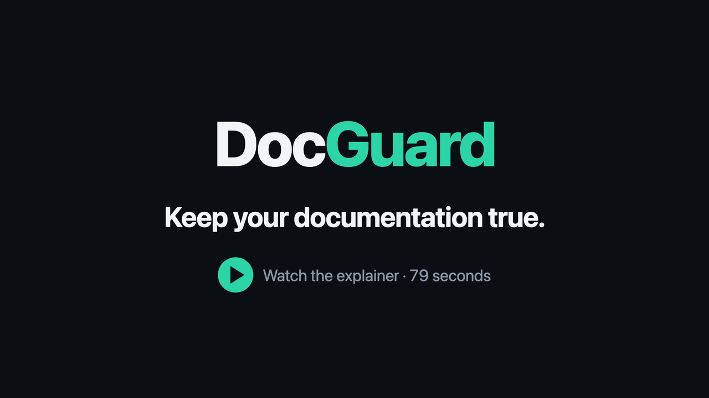

<!-- docguard:translation source=README.md lang=es reviewed=2026-10-10 -->
<!-- El README en inglés es la fuente canónica. Esta es una versión curada — los
     números y listas volátiles viven solo en el original para que nunca diverjan del código. -->

# 🛡️ DocGuard

[English](README.md) · [Português (BR)](README.pt-BR.md) · **Español**

> **La capa de enforcement para Spec-Driven Development.**
> Valida. Puntúa. Garantiza. Entrega documentación que los agentes de IA realmente pueden usar.

[](https://github.com/raccioly/docguard/actions/workflows/ci.yml)
[](https://www.npmjs.com/package/docguard-cli)
[](https://pypi.org/project/docguard-cli/)
[](https://opensource.org/licenses/MIT)

[](https://github.com/raccioly/docguard/blob/main/docs/media/docguard-explainer.mp4)

▶️ **Video de 79 segundos (en inglés)**, con subtítulos.

---

> **✨ Mira lo que DocGuard detecta en 30 segundos — sin instalar nada:**
> ```bash
> npx docguard-cli demo
> ```

## ¿Qué es DocGuard?

DocGuard es la herramienta de enforcement del **Canonical-Driven Development (CDD)**.
En CDD, la documentación es la fuente de la verdad. DocGuard
**verifica, de forma determinista, que siga siendo verdad respecto al código**.

Un resultado verde de DocGuard significa *"los documentos coinciden con el código, y se
puede comprobar"*. No significa solo "los archivos existen". DocGuard extrae rutas,
esquemas, variables de entorno, conteos y afirmaciones de los documentos, y los compara
con el código real. El núcleo no llama a ningún LLM: es determinista, funciona sin
conexión y se puede auditar.

## Inicio rápido

```bash
# en el directorio de tu proyecto
npx docguard-cli init       # crea los documentos canónicos (detecta tu stack)
npx docguard-cli guard      # valida — verde significa "docs correctos"
npx docguard-cli score      # nota de madurez de la documentación (0-100)
```

> **El modo estricto es el predeterminado.** `docguard guard` termina con código 4 cuando una verificación que aplica a tu proyecto no examinó nada (por ejemplo, no hay referencia de API aunque existan rutas). DocGuard muestra qué añadir. Una verificación que no aplica se omite. Un formato que DocGuard no lee solo se informa y no hace fallar la ejecución. ¿Actualizaste y el build se puso rojo? Lee [Actualizar al modo estricto](https://raccioly.github.io/docguard/upgrading-to-strict) (en inglés). Para mantener el comportamiento anterior, define `"enforcement": "standard"` en `.docguard.json`.

Para un proyecto existente, el camino inverso funciona mejor:

```bash
npx docguard-cli generate --plan --write   # ingeniería inversa: docs desde el código
```

## Los 5 comandos del día a día

| Comando | Qué hace |
|:--------|:---------|
| `init`  | Inicializa el proyecto (detecta el stack automáticamente) |
| `guard` | Compara los documentos con el código. Es el control final en CI |
| `diff`  | Muestra las brechas entre docs y código (`--since <ref>` para impacto de PR) |
| `sync`  | Regenera las secciones de "verdad del código" en los documentos |
| `score` | Nota de madurez CDD, con desglose por categoría |

La lista completa de comandos, validadores y flags está en el
[README en inglés](README.md#usage). DocGuard la mantiene
sincronizada con el código.

## Integración con IA (nativa, no improvisada)

DocGuard está hecho para que lo usen **agentes**, no solo personas:

- **Servidor MCP** — `claude mcp add docguard -- npx docguard-cli mcp` expone
  guard/score/explain/verify/diagnose como herramientas nativas para Claude,
  Cursor y cualquier cliente MCP.
- **Contrato JSON estable** — `guard --format json` da códigos de hallazgo
  estables. Puedes explicarlos con `docguard explain <CÓDIGO>` y suprimirlos en línea.
- **SARIF** — `guard --format sarif` se integra con GitHub Code Scanning.
- **llms.txt / llms-full.txt / context pack** — archivos de contexto para
  los LLMs que leen el repositorio.
- **GitHub Action** — anotaciones en el diff del PR y un comentario fijo
  con el impacto en los documentos canónicos.
- **`agents --sync`** — AGENTS.md es la fuente de
  CLAUDE.md, las reglas de Cursor, las instrucciones de Copilot y demás. No copias
  nada a mano y no hay drift.

Guía completa: [docs/ai-integration.md](docs/ai-integration.md) (en inglés).

## Documentación en otro idioma

DocGuard lee documentación escrita en cualquier idioma. Busca etiquetas estructurales: los títulos obligatorios de los documentos canónicos, la sección de cambios aún no publicados del changelog, las secciones del README, los nombres de las secciones de Spec Kit y las palabras de estado de los registros de decisión. DocGuard reconoce estas etiquetas por **id**, no por el texto en inglés. Por eso un proyecto en español o portugués no necesita títulos en inglés. Hay tres formas de indicar qué título es cuál. DocGuard las prueba en este orden:

1. **Un marcador.** Escribe `<!-- docguard:heading system-overview -->` en la línea justo debajo del título que ya tienes. Funciona en cualquier idioma y no requiere configuración. La lista cerrada de ids está en [Documents in other languages](https://raccioly.github.io/docguard/languages.html) (en inglés). `docguard explain STR009` también la muestra.
2. **`docs.language`.** Define una etiqueta [BCP 47](https://www.rfc-editor.org/info/bcp47) en `.docguard.json`. DocGuard acepta entonces los títulos y palabras integrados de ese idioma. Esta versión incluye portugués (`pt`, es decir `pt-BR` y `pt-PT`) y español (`es`). DocGuard ignora las mayúsculas, las tildes y la numeración de sección al principio. El inglés siempre se acepta, así que los documentos mixtos funcionan.
3. **`docs.labelAliases`.** Tu propia redacción, por id. Se suma al conjunto integrado y nunca lo reemplaza.

```json
{
  "docs": {
    "language": "es",
    "labelAliases": { "requirements": ["Requisitos del sistema"] }
  }
}
```

El ejemplo anterior muestra la redacción propia de un equipo, añadida al conjunto integrado. No es una traducción integrada.

**Un idioma sin conjunto integrado** (`"de"`, por ejemplo) también se acepta. DocGuard no puede distinguir una sección ausente de una escrita en alemán. Por eso no señala como ausente un título obligatorio sin marcador y sin alias. El documento aparece en "DocGuard could not read" con la causa `language-not-supported` y lo que hay que añadir. El código de salida no cambia. Un documento llamado `<nombre>.<idioma>.md`, o dentro de `i18n/<idioma>/` o `locales/<idioma>/`, se lee en ese idioma cuando `docs.language` está definido. DocGuard nunca deduce el idioma del texto.

**Métricas de calidad del texto.** DocGuard omite la voz pasiva y la legibilidad de Flesch en todos los idiomas salvo el inglés. Informa cada omisión con su motivo en lugar de dar un número. La longitud de las frases se sigue midiendo. Para portugués y español, DocGuard ya mide la negación, las condiciones, las frases compuestas y los pronombres ambiguos (DQ007, DQ008, DQ003, DQ002), con listas de palabras revisadas por un hablante nativo. Los demás idiomas siguen omitiendo estas métricas.

**Documentos nuevos.** `docguard init` y `docguard generate` escriben el marcador bajo cada título obligatorio que generan. Con `docs.language` en `pt` o `es`, escriben también el título en ese idioma (el changelog como `## [Não lançado]` o `## [Sin publicar]`). Nunca reescriben un documento que ya existe.

Puedes marcar una sección obligatoria que no aplica a tu proyecto con `<!-- docguard:section <slug> n/a — motivo -->`. `<slug>` es el id de la sección (por ejemplo `system-overview`). El motivo debe empezar con una letra o un dígito de `A-Z`, `a-z` o `0-9`. Guía completa: [Documents in other languages](https://raccioly.github.io/docguard/languages.html) (en inglés).

## Documentación

Las guías completas están en inglés, en
**[raccioly.github.io/docguard](https://raccioly.github.io/docguard/)**:

| Si quieres | Guía |
|:-----------|:-----|
| Instalar con npm, PyPI, Homebrew, Docker, GitHub Action o Spec Kit | [Installation](https://raccioly.github.io/docguard/installation.html) |
| Adoptar DocGuard en un repositorio que ya tiene código | [Existing Projects](https://raccioly.github.io/docguard/guides/existing-projects.html) |
| Usarlo con GitHub Spec Kit | [Spec Kit](https://raccioly.github.io/docguard/guides/spec-kit.html) |
| Bloquear pull requests en CI | [Continuous Integration](https://raccioly.github.io/docguard/guides/ci.html) |
| Saber qué lenguajes y frameworks lee | [Languages and Frameworks](https://raccioly.github.io/docguard/reference/languages.html) |
| Conectar tu agente de código | [Coding Agents](https://raccioly.github.io/docguard/reference/agents.html) |
| Entender un código de hallazgo | [Finding Codes](https://raccioly.github.io/docguard/reference/findings.html) |
| Resolver un problema | [Troubleshooting](https://raccioly.github.io/docguard/guides/troubleshooting.html) |

## Instalación permanente

```bash
npm install -g docguard-cli    # Node.js 18+
# o vía Python:
pip install docguard-cli       # wrapper de PyPI (requiere Node.js 18+)
```

## Comunidad

- [Discusiones](https://github.com/raccioly/docguard/discussions) — preguntas e ideas
- [Issues](https://github.com/raccioly/docguard/issues) — bugs y peticiones de features
- [CHANGELOG](CHANGELOG.md) — historial completo de versiones
- [Cómo contribuir](CONTRIBUTING.md)

---

**Licencia MIT** · Hecho para equipos que tratan la documentación como un contrato, no como un adorno.
