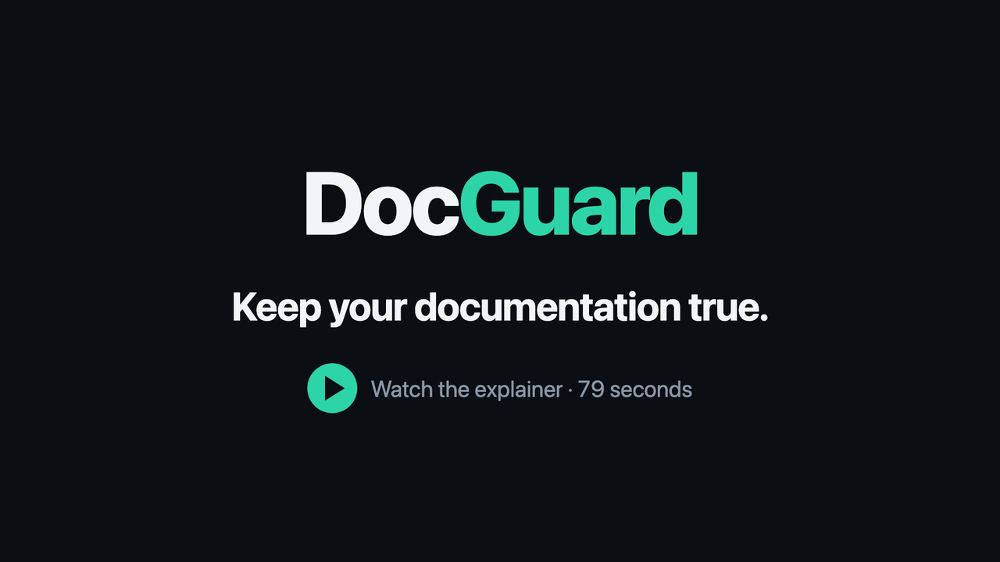
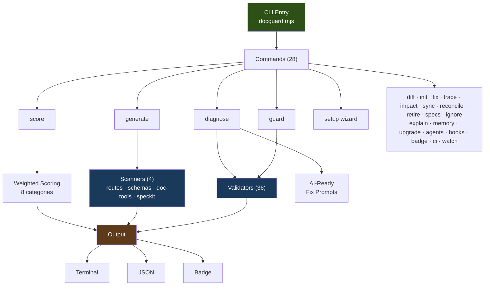

# 🛡️ DocGuard

**English** · [Português (BR)](README.pt-BR.md) · [Español](README.es.md)

> **The enforcement layer for Spec-Driven Development.**
> Validate. Score. Enforce. Ship documentation that AI agents can actually use.

[](https://github.com/raccioly/docguard/actions/workflows/ci.yml)
[](https://www.npmjs.com/package/docguard-cli)
[](https://www.npmjs.com/package/docguard-cli)
[](https://pypi.org/project/docguard-cli/)
[](https://opensource.org/licenses/MIT)
[](https://nodejs.org)
[-green)](package.json)
[](https://github.com/github/spec-kit)
[](https://glama.ai/mcp/servers/raccioly/docguard)
[](https://registry.modelcontextprotocol.io/)
[](https://mcp.market/server/raccioly-docguard)

[](https://github.com/raccioly/docguard/blob/main/docs/media/docguard-explainer.mp4)

▶️ **Watch the 79-second explainer** (sound on, with captions): what DocGuard checks, how it guards the merge, and how to start.

---

> **✨ See what DocGuard catches in 30 seconds — no install, no setup:**
> ```bash
> npx docguard-cli demo
> ```
> Runs against a built-in sample project with planted drift. It shows you the findings and how to fix them.


📚 **[Documentation](https://raccioly.github.io/docguard/)**: [Installation](https://raccioly.github.io/docguard/installation.html) · [Existing projects](https://raccioly.github.io/docguard/guides/existing-projects.html) · [Spec Kit](https://raccioly.github.io/docguard/guides/spec-kit.html) · [CI](https://raccioly.github.io/docguard/guides/ci.html) · [Languages and frameworks](https://raccioly.github.io/docguard/reference/languages.html) · [Coding agents](https://raccioly.github.io/docguard/reference/agents.html) · [Finding codes](https://raccioly.github.io/docguard/reference/findings.html) · [Troubleshooting](https://raccioly.github.io/docguard/guides/troubleshooting.html)

---

## Table of Contents

- [What is DocGuard?](#what-is-docguard)
- [Why DocGuard?](#why-docguard)
- [Quick Start](#-quick-start)
- [Spec Kit Integration](#-spec-kit-integration)
- [Usage](#usage)
- [Validators](#-validators)
- [Reading a finding](#-reading-a-finding)
- [Templates](#-templates)
- [AI Agent Support](#-ai-agent-support)
- [Slash Commands](#-slash-commands)
- [Examples](#-examples)
- [Testing](#-testing)
- [Enterprise Adoption](#-enterprise-adoption)
- [CI/CD Integration](#%EF%B8%8F-cicd-integration)
- [What's New](#-whats-new)
- [File Structure](#-file-structure)
- [Docs in another language](#-writing-your-docs-in-another-language)
- [Configuration](#%EF%B8%8F-configuration)
- [Research Credits](#-research-credits)

---

## What is DocGuard?

DocGuard enforces **Canonical-Driven Development (CDD)**. In CDD, the documentation is the source of truth, not an afterthought. An agent writes the docs, and DocGuard checks them.

| Traditional Development | Canonical-Driven Development |
|:----|:----|
| Code first, docs maybe | Docs first, code conforms |
| Docs rot silently | Drift is tracked and enforced |
| Docs are optional | Docs are required and validated |
| One agent, one context | Any agent, with shared context from canonical docs |

DocGuard is an official [GitHub Spec Kit](https://github.com/github/spec-kit) community extension. It checks the files that Spec Kit creates. Your specs stay in good shape from the start to the end of the project.

🧭 **[How it works (10-page brief)](https://raccioly.github.io/docguard/docguard-explained.html)** ([PDF](https://raccioly.github.io/docguard/docguard-explained.pdf)) · 📖 **[Philosophy](PHILOSOPHY.md)** · 📋 **[CDD Standard](STANDARD.md)** · ⚖️ **[Comparisons](https://github.com/raccioly/docguard/blob/main/COMPARISONS.md)** · 🔬 **[Validation](https://github.com/raccioly/docguard/blob/main/VALIDATION.md)** · 🗺️ **[Roadmap](https://github.com/raccioly/docguard/blob/main/ROADMAP.md)**

### Architecture



> **Distribution**: Node.js core (npm) · Python wrapper (PyPI) · GitHub Action (`action.yml`) · Spec Kit Extension (ZIP)

---

## Why DocGuard?

DocGuard reads what your documentation says and checks it against your code. When a statement is wrong, DocGuard gives your agent a repair task with the file and the line. The checks are deterministic. They cover supported facts, references and generated sections.

DocGuard never changes a requirement or a decision that a person wrote. When the code differs from such a document, DocGuard reports the difference, and a person decides.

DocGuard checks only what it can prove. Each guard result lists the checks that ran. The CDD grade shows how complete your documentation structure is. It does not show whether the statements are true.

To check an exact statement, declare it in `.docguard-evidence.json`. DocGuard then compares that statement with current local evidence. A statement that DocGuard cannot check stays marked as unchecked. Coverage gaps and open claims stay visible, so your team can choose how strictly to enforce.

A 2026 study found that repository context files did not usually make agents more successful, and each run cost more, in the settings it tested. The same study found that agents follow the instructions they get. So keep the context short and correct, and measure the results. The study does not prove that DocGuard works. [Evaluating AGENTS.md, revised June 2026](https://arxiv.org/abs/2602.11988v2).

The [current roadmap](https://github.com/raccioly/docguard/blob/main/ROADMAP.md) puts four things first: accurate detection, reproducible evidence, document lifecycle management, and regression cases from contributors. DocGuard removes released plans and superseded specs from the active agent context. You can recover them from Git.

---

## ⚡ Quick Start

> **Package names:** the repository is `raccioly/docguard`. The package is **`docguard-cli`** on both [npm](https://www.npmjs.com/package/docguard-cli) and [PyPI](https://pypi.org/project/docguard-cli/). The command you run is `docguard`. All three are the same project. The `-cli` suffix is only the registry name. The package runs **no install scripts**, so `npm i -g docguard-cli --ignore-scripts` does the same thing.

### Node.js (npm)

```bash
# No install needed — run directly
npx docguard-cli diagnose

# Or install globally
npm i -g docguard-cli
docguard diagnose
```

> **Strict is the default.** `docguard guard` exits 4 when a check that applies to your project examined nothing. For example, you have routes but no API reference. DocGuard then prints what to add. DocGuard skips a check that does not apply. It reports a layout that it cannot read, and the run does not fail. Did a red build appear after you upgraded? Read [Upgrading to Strict](https://raccioly.github.io/docguard/upgrading-to-strict) (also in [`docs/upgrading-to-strict.md`](docs/upgrading-to-strict.md)). To keep the earlier behavior, set `"enforcement": "standard"` in `.docguard.json`. Under strict, a `"validators": { "<key>": false }` entry no longer switches a check off.

### Python (PyPI)

```bash
pip install docguard-cli
docguard diagnose
```

> **Note:** The Python package is a thin wrapper that runs `npx`. You need Node.js 18+ on the system.

### Docker (MCP server)

The MCP server is a container image on GHCR. You do not need Node.js. The image is public, so you do not need to sign in to pull it:

```bash
# Run the MCP server against the current directory
docker run -i --rm -v "$PWD":/workspace ghcr.io/raccioly/docguard:latest
```

The entrypoint uses the **stdio** MCP transport. Stdout carries the JSON-RPC messages, so keep every other output off it. Mount the project you want checked at `/workspace`. The tools check it by default. A `projectDir` in a tool call must be `/workspace` or a directory inside it. To serve another mounted tree, add `--root <dir>` after the image name.

In CI, pin a version instead of using `latest`:

```bash
docker run -i --rm -v "$PWD":/workspace ghcr.io/raccioly/docguard:0.34.9
```

The server is **read-only**: it only reads the mounted project.

### More ways to integrate

- **pre-commit** — runs guard on the changed files at every commit:
  ```yaml
  repos:
    - repo: https://github.com/raccioly/docguard
      rev: v0.49.0
      hooks: [{ id: docguard-guard }]   # docguard-guard-full for pre-push
  ```
- **MCP** (Claude, Cursor, any MCP client) — `claude mcp add docguard -- npx -y docguard-cli mcp`; read-only tools that check docs (guard, score, diagnose, …) and that read them one section at a time. The full list is in [docs/ai-integration.md](docs/ai-integration.md). The registry manifest is in the repository (`server.json`, ready for Smithery).
- **GitLab CI** — a component at [`templates/ci/gitlab-component.yml`](templates/ci/gitlab-component.yml) (a guard, score or ci job with a SARIF artifact).
- **Homebrew** — `brew install raccioly/tap/docguard`. The release workflow builds the formula from the template in [`packaging/homebrew/`](https://github.com/raccioly/docguard/tree/main/packaging/homebrew) and the published npm tarball. It then pushes the formula to the tap.

### Core Workflow

```bash
# 1. Initialize docs for your project
npx docguard-cli init

# 2. Or reverse-engineer docs from existing code
npx docguard-cli generate

# 3. AI diagnoses issues and generates fix prompts
npx docguard-cli diagnose

# 4. Validate — use as CI gate
npx docguard-cli guard

# 5. Check maturity score
npx docguard-cli score
```

### The AI Loop

```
diagnose  →  AI reads prompts  →  AI fixes docs  →  guard verifies
   ↑                                                       ↓
   └───────────────── issues found? ←──────────────────────┘
```

`diagnose` is the main command. It runs all validators and turns every failure into a fix prompt for an agent. It prints a plan to fix them. Your agent runs it, fixes the docs, and runs `guard` to check the fixes.

### Mechanical vs. agent fixes

DocGuard splits drift into two kinds and labels each one:

| Kind | Example | How it's fixed |
|------|---------|----------------|
| **Mechanical** (deterministic) | An endpoint documented in `API-REFERENCE.md` that the OpenAPI spec shows is gone | `docguard fix --write` deletes the row + detail block itself — **no AI** |
| **Agent** (needs judgment) | Rewriting an X-Ray prose section as CloudWatch; writing a new endpoint's request/response | Sent to an agent through `diagnose` / `fix --doc` prompts |

`docguard fix --write` changes only docs marked `<!-- docguard:generated true -->` (override with `--force`). Running it again has no extra effect. It prints exactly what it changed. The agent handles prose.

### Continuous documentation workflow

```
guard ──▶ fix --write (mechanical, auto) ──▶ guard ──▶ diagnose (agent prompts for the rest)
```

- **CI / pre-commit:** `docguard hooks --type pre-commit --auto-fix` installs a hook. The hook applies mechanical fixes, stages the docs again, and runs `guard`. DocGuard shows anything left as agent prompts.
- **Agent-driven:** `docguard diagnose --auto` creates missing docs **and** applies mechanical fixes. It then prints prompts for the rewrites that remain.
- **JSON for automation:** `guard`/`diagnose --format json` include a `mechanicalFixes` array and tag each finding `mechanical` or `agent`. An agent can then apply the fix or hand it off.

---

## ☁️ AWS AI-DLC Integration

DocGuard reads [AWS AI-DLC](https://github.com/awslabs/aidlc-workflows) workspaces directly. It reports traceability targets that no longer exist, gaps left in completed stages, deliverables removed after a unit, and agent memory that names something that is gone (AID001–AID004, MEM001–MEM002). DocGuard also ships as an AI-DLC plugin. Its `docguard-guard` sensor fails a construction gate when the stage introduced drift. See the [AI-DLC guide](docs/guides/aidlc.md).

## 🌱 Spec Kit Integration

DocGuard is a [community extension](https://github.com/github/spec-kit/blob/main/extensions/README.md) for GitHub's **Spec Kit** framework. Spec Kit **creates** specs with slash commands such as `/speckit.specify` and `/speckit.plan`. DocGuard **checks** their quality.

### How They Work Together

```
┌─────────────────┐          ┌──────────────────┐
│    Spec Kit      │          │    DocGuard       │
│                  │          │                   │
│  /speckit.specify│ ──────→  │  docguard guard   │
│  Creates specs   │          │  Validates specs  │
│  (AI-driven)     │          │  (automated)      │
└─────────────────┘          └──────────────────┘
```

| Phase | Tool | What happens |
|:------|:-----|:-------------|
| 1. Initialize | `specify init` | Creates `.specify/` directory and templates |
| 2. Write specs | `/speckit.specify` | AI creates `spec.md` with FR-IDs, user stories |
| 3. **Validate** | **`docguard guard`** | Checks spec quality (mandatory sections, FR/SC IDs) |
| 4. Plan | `/speckit.plan` | AI creates `plan.md` with technical context |
| 5. **Validate** | **`docguard guard`** | Checks plan quality (sections, structure) |
| 6. Tasks | `/speckit.tasks` | AI creates `tasks.md` with phased breakdown |
| 7. **Validate** | **`docguard guard`** | Checks task quality (phases, T-IDs) |
| 8. Implement | `/speckit.implement` | AI writes code |
| 9. **Enforce** | **`docguard guard`** | Final check in CI/CD |

### What DocGuard Validates in Spec Kit Projects

- **spec.md** — Mandatory sections (User Scenarios, Requirements, Success Criteria), FR-xxx IDs, SC-xxx IDs
- **plan.md** — Summary, Technical Context, Project Structure sections
- **tasks.md** — Phased task breakdown (Phase 1, 2, 3+), T-xxx task IDs
- **constitution.md** — Detected at `.specify/memory/constitution.md` or project root
- **Requirement traceability** — FR, SC, NFR, US, AC, UC, SYS, ARCH, MOD, T IDs

### Installing as a Spec Kit Extension

`docguard init` does this for you. It needs the `specify` CLI on your PATH (Spec Kit ≥ 0.11.2, the
minimum version the extension declares). `init` sets up Spec Kit for the coding agent that the
repository already uses. Then it registers the DocGuard extension that ships inside the installed
package. The registration downloads nothing.

If the registered extension comes from another DocGuard release,
`init` re-registers it when the versions differ, and it keeps the priority. `docguard upgrade --apply` does the same. `init` says the
workflow hooks are active only when each mandatory hook resolves to a command file that your agent
can run. The mandatory hooks are `speckit.docguard.brief` (before specify),
`speckit.docguard.preflight` (before tasks) and `speckit.docguard.guard` (after implement). If a hook
does not resolve, `init` names the missing one.

Spec Kit registers no extension commands for its `generic` integration. For `generic`, DocGuard
writes them next to Spec Kit's own commands (`.agent/commands/` by default). DocGuard prints every
failure with Spec Kit's own error and the command to run by hand. Only `init` and `upgrade --apply`
change Spec Kit. Other commands print a one-line hint at most.

DocGuard puts its own skills where your agent reads them: in `.claude/skills/` for Claude Code (or in
the skills directory of another skills-based integration), and in `.agent/` for the generic
integration or for an agent that DocGuard cannot place. A commands-only integration such as Gemini
gets Spec Kit's `speckit.docguard.*` commands and no extra copies. The command and skill files run
`docguard` from your PATH when it is installed. Otherwise they run `npx --yes docguard-cli@<version>`,
pinned to the release they shipped with. They never fetch `@latest`.

DocGuard prints suggestions (`Next: …`, `Fix: …`). A suggestion names a slash command only when the
command file exists for your agent. It uses the form your agent uses: `/speckit-docguard-guard` in
Claude Code, `/speckit.docguard.guard` for `generic`. Otherwise it prints the CLI command.

`docguard init` registers the copy of the extension inside the installed package. To register
it yourself, use a release ZIP or a local checkout. A bare `specify extension add docguard` does
not work on a default Spec Kit setup. DocGuard is in Spec Kit's community catalog, and Spec Kit uses
that catalog only to find extensions.

```bash
specify extension add docguard --from https://github.com/raccioly/docguard/releases/download/vX.Y.Z/spec-kit-docguard-vX.Y.Z.zip
specify extension add ./node_modules/docguard-cli/extensions/spec-kit-docguard --dev
```

See the [Spec Kit guide](https://raccioly.github.io/docguard/guides/spec-kit.html) for the hooks,
the spec lifecycle registry and an end-to-end flow.

The registration adds the `speckit.docguard.*` commands listed in
[`extension.yml`](extensions/spec-kit-docguard/extension.yml) and the workflow hooks that run them.
Skills-based agents such as Claude Code invoke the commands as `/speckit-docguard-guard` and so on.

---

## Usage

DocGuard ships **28 commands**: the "Daily 5" and 23 situational tools. The tools include lifecycle reconciliation, doc dependency review, requirement anchors, agent-rule resolution, the suppression listing, retirement and spec tracking, the zero-install `demo`, the `mcp` server, and the `ci` pipeline gate. Six more one-shot scaffolders are available with `docguard init --with <name>`. Legacy command forms still work until v1.0 and print their replacements.

**The Daily 5** — what you use 95% of the time:

| Command | What It Does |
|:--------|:-------------|
| `init`  | Set up a project (`--wizard` for interactive · `--with <name>` for scaffolders) |
| `guard` | Check against canonical docs — 36 validators |
| `diff`  | Show gaps between docs and code (`--since <ref>` for impact mode) |
| `sync`  | Refresh the doc sections that come from code, including the `module-graph` and `entity-diagram` mermaid diagrams drawn from code. This keeps memory up to date |
| `score` | CDD maturity score for the doc structure (0-100; not a guard verdict; `--diff` shows the change between refs; `--dora` shows DORA documentation-quality and AI-capability evidence) |

**Tools (situational, but day-to-day useful):**

| Command | Purpose |
|:--------|:--------|
| `demo` | Zero-install demo — runs guard on a built-in sample project that has drift (`npx docguard-cli demo`) |
| `diagnose` | Runs guard and prints fix prompts for an agent, in one command |
| `fix` | Print fix instructions for an agent, for specific docs (`--doc <name> --format prompt`) |
| `fix --write` | Apply deterministic fixes (no AI — version bumps, counts, anchors, sections) |
| `fix --history` | Log of every mechanical fix applied (from `.docguard/fixed.json`) |
| `generate` | Write docs from your existing code (`--plan` for an agent scan). It also draws Mermaid ER diagrams in DATA-MODEL.md from the schemas it detects (Prisma/Drizzle/TypeORM/Sequelize/Django/Rails). `--spec <area>` writes an **as-built Spec Kit spec** for one code area. The spec has one requirement candidate for each route, exported symbol, env var or entity found there. The agent writes every statement. DocGuard registers the spec as `origin: as_built`. Guard then reports new or vanished facts (`SPR007`) |
| `agent` | One-shot agent task graph, or a size-limited packet of current evidence for one task (`--task <text>`, `--format json`) |
| `explain <warning\|CODE>` | Paste any warning, or a finding code like `SEC001`. You get the validator's docstring, the fix, and how to suppress it |
| `verify --evidence` | Check exact declarations that link a statement to its source. The sources can be typed JSON values, counts of bounded collections, saved oasdiff JSON, and saved Buf JSON Lines. The result tells apart these cases: verified within scope, contradiction, stale inputs, inconclusive evidence, and unsupported formats. |
| `verify --semantic` | List the documented numbers, limits and enums (retention days, rate limits, GSI/role counts, status enums) as tasks for an agent to check against the code. Regex and AST checks cannot see this kind of drift |
| `verify --instructions` | Check AGENTS.md and CLAUDE.md for drift: duplicate rules, never-versus-always contradictions, stale file pointers and unknown commands. It also gives clustered rule pairs to an agent as tasks to judge |
| `feedback` | Review any finding, or a synthetic false-positive, false-negative or unsupported fixture. The command checks its opposite control, reduces it the same way every time, searches open and closed duplicates, and can write a test-only contribution. Nothing is submitted automatically. |
| `retire` | Find planning material that is finished or replaced (`--plan`/`--check`; `--fail-on-warning` fails on advisory candidates). Then, when you ask, remove clean tracked docs from the active agent context. `.docguard-archive.json` records the data needed to recover them and the identities of retired requirements. `--retention-ref` proves that the source revision is still reachable. This is separate from the Spec Kit Archive extension, which consolidates feature documents. |
| `reconcile` | Build a read-only code↔spec review graph since a Git ref. It sorts changes into mechanical facts, approved intent, decisions, unrelated changes and unsupported evidence. `--write` applies only mechanical refreshes of generated sections. |
| `review` | Lists doc sections whose covered code changed since their last review (`--accept <doc>#<id> --reason`, `--prune`, `--suggest`) |
| `anchors` | Lists every `@implements`/`@req` tag, the requirement it resolves to, and the symbol, statement, route or file it anchors to. It also shows the tier that resolved the tag (`--spec <id>`, `--file <path>`, `--format json`) |
| `ignore` | Lists every suppression in the project (`.docguardignore` entries with their `# reason` and `expires:` date, `.docguard.json` ignore arrays, inline pragmas, N/A markers, the baseline) with its state. `--format claimspec` exports the `.docguardignore` entries that have a reason as a claimspec `ignore` document, and reports what it left out |
| `rules` | Shows which agent instruction files each harness (Codex, Claude Code, Cursor, Copilot, OpenHands) loads for a path, why, and how many bytes (`--for <path>`, `--harness`) |
| `specs` | Keep the versioned spec registry, run preflight on new specs, and complete specs through transactions that need evidence, with bounded outcomes and a regenerated active context. A verified living spec can record later reviewed maintenance, and you do not reopen it or copy it. `specs require` is the spec-first gate: a change to governed paths must name its spec or declare `Spec-Exempt: <kind> — <reason>`. |
| `specs --check` / `specs --write` | Check or refresh `.docguard-specs.json`. This file is the byte-stable index of immutable spec IDs, reviewed lifecycle, lineage and scope, artifact digests, task state, test evidence with an explicit scope, and archive tombstones. A refresh keeps the reviewed block. |
| `specs preflight [--path <spec>]` | Before you write a spec, print the current spec lifecycle and evidence. Before planning, check the generated draft for structural blockers, and report overlap in meaning as evidence for review only. |
| `specs approve --id <spec-id>` | Record a person's approval of a spec in the registry. With `--delivery`, record its `planned`, `in_progress` or `implemented` state. By default the command only shows its plan, and `--write` records it. `--persistence` and a repeatable `--canonical-doc` record the reviewed scope. `specs complete` does the verification. |
| `mcp` | MCP server. It gives Claude, Cursor and any MCP client native tools for checking (guard, score, explain, verify, report, diagnose) and for exact doc navigation (docs for a file, document outline, one section, task context). `docguard_guard` returns each fact once, unless you call it with `detail: "full"`. Stdio: `claude mcp add docguard -- npx docguard-cli mcp`. Team-shared HTTP: `docguard mcp --transport http --port 8585` (loopback by default; a bind to another address needs `--api-key`) |
| `report` | Compliance evidence bundle for audits: combined readiness, guard verdict, structural maturity, ALCOA+ attributes and fix history. It carries the git commit and a sha256 integrity hash that shows tampering (`--format json`, `--out <file>`). It is evidence, not a gate: it always exits 0 |
| `ci` | Pipeline gate: guard and structural maturity in one command, with a READY/ATTENTION/BLOCKED assessment. It never creates files or changes your source. It writes only its own `.docguard/history.jsonl` (opt out: `--no-history`). `--threshold <n>` fails below a score, `--fail-on-warning` is strict mode, `--format json` is for parsers |
| `score --trend` | Score history from recorded `ci` runs: sparkline, change, and the last 10 runs with their commits |
| `memory` | Accuracy summary for each domain (endpoints / entities / env / tech) |
| `memory --diff` | Shows which claims do not match the code |
| `policy` | The enforcement ladder: which advisory finding codes, judging by CI history, are ready to become warnings or errors |
| `sensor --aidlc` | AWS AI-DLC's sensor contract, in one JSON line. It passes when the work in progress added no drift since HEAD. The DocGuard AI-DLC plugin runs it at construction gates. `--help` does not list it, because it is for machines |
| `memory --pack` | Write `.docguard/context-pack.md` — short session-start context for agents, stamped with code truth |
| `score --diff` | Shows which checks pulled each category down |
| `trace` / `trace --reverse <file>` | Requirements traceability — forward AND reverse |
| `trace --features` | Spec-adherence score for each feature (requirement coverage, task completion, task evidence, artifacts), worst first, with fix hints |
| `upgrade [--apply] [--pr]` | Check npm for a newer CLI (the only command that contacts a registry) and migrate the `.docguard.json` schema; `--pr` opens a PR. When the installed release is over 14 days old, guard's text output, the MCP server and the context pack suggest running `docguard upgrade`. Nothing upgrades by itself (`DOCGUARD_NO_UPDATE_HINT=1` hides the note) |
| `watch` | Live mode: runs guard again when files change |

**`init --with <name>` scaffolders** — picked at init time:

| Scaffolder | What It Generates |
|:-----------|:------------------|
| `agents` | `AGENTS.md`, `CLAUDE.md`, `.cursor/rules/`, `.github/copilot-instructions.md` |
| `hooks` | Git pre-commit / pre-push hooks |
| `ci` | GitHub Actions / pipeline YAML |
| `badge` | Shields.io score badges for README |
| `llms` | `llms.txt` (AI-friendly summary) |
| `publish` | External doc-site config (Mintlify) — experimental |

Run one (`docguard init --with hooks`) or several together (`docguard init --with agents,hooks,badge,ci`).

To declare an exact fact, copy `templates/evidence-manifest.json` to
`.docguard-evidence.json`. Point its literal Markdown template at one unique
statement. Then link that value to a supported local source. Run
`docguard verify --evidence --format json` before you turn on the guard in CI.
External compatibility declarations read saved oasdiff or Buf output. They need
a current SHA-256 identity for every declared repository input.

**Deprecation aliases** — `setup` · `agents` · `hooks` · `badge` · `llms` · `publish` · `impact` still work until v1.0 and print a yellow warning on stderr. `audit → guard` is permanent and silent. `ci` is a current command for pipelines.

### CLI Flags

| Flag | Description | Commands |
|:-----|:------------|:---------|
| `--dir <path>` | Project directory (default: `.`). If you set it, DocGuard does not suggest a parent root | All |
| `--verbose` | Show detailed output | All |
| `--quiet` / `-q` | Hide the banner, for hooks, CI loops and scripts | All |
| `--format json` | Output for machines (clean JSON, no ANSI codes) | guard, score, diff, trace, diagnose, memory, impact, explain, verify, reconcile, retire, specs, ignore |
| `--format claimspec` | claimspec v1 `ignore` document on stdout, checked against the bundled schema; anything that could not be exported goes to stderr | ignore |
| `--format sarif` | SARIF 2.1.0 output — findings as rules/results for GitHub Code Scanning and SARIF dashboards | guard |
| `--format junit` | JUnit XML output — one testcase per validator, for GitLab CI (`artifacts:reports:junit`), Jenkins, Azure DevOps, CircleCI | guard |
| `--update-baseline` | Adopt DocGuard on a legacy repo with no red build on day one. It saves today's findings in a committed `.docguard.baseline.json`. Guard and ci then fail only on NEW drift. DocGuard always shows what it hides ("N pre-existing finding(s) suppressed"), and `--no-baseline` shows everything | guard |
| `--full` | Generate `llms-full.txt` (full doc text included) instead of the `llms.txt` link index | llms |
| `--compact` | With `--format json`: each fact once. The MCP guard tool returns this form by default | guard |
| `--pack` | Write `.docguard/context-pack.md`: session-start context for agents | memory |
| `--symbols` | With `--pack`: add a symbol map (the most central files and their exported names, within `memory.symbolMap.maxBytes`). It is off by default, because the frozen agent-context benchmark (protocol v3) found no regression and no benefit | memory |
| `--sync` | Regenerate the agent files (CLAUDE.md, Copilot, Cursor, …) from AGENTS.md. Each file carries a hash marker. DocGuard never changes hand-written files without `--force` | agents |
| `--check` | CI check for the synced agent files. It exits 2 when one is stale | agents |
| `--force` | Overwrite existing files (creates `.bak` backups) | generate, agents, init |
| `--force-redo` | Bypass ping-pong suppression in `.docguard/fixed.json` | fix --write |
| `--profile <name>` | Starter / standard / enterprise | init |
| `--no-spec-kit` | Skip Spec Kit: no `specify` call and no `.specify/`; DocGuard's own agent skills still install | init |
| `--spec-kit` | With `--profile starter`, initialize Spec Kit too (starter skips it by default) | init |
| `--changed-only [--since <ref>]` | Light pre-commit mode: runs the fast validators (including covered-doc dependencies) on changed files only | guard |
| `--timings` | Run time of each validator, slowest first | guard |
| `--show-failing` | Show warnings/errors even when status is PASS | guard |
| `--pin` | Save the running CLI version in `.docguard.json`, so results can be reproduced | guard |
| `--diff` | Detail for each category | score, memory |
| `--check-only` | Exit 1 if behind (for CI) | upgrade |
| `--apply` | Actually run the migration | upgrade |
| `--pr` | Open a PR with the migration | upgrade |
| `--reverse <file>` | Reverse traceability (code → docs) | trace |
| `--no-indirect` | Skip the reverse-import-graph analysis (docs about modules that import a changed file) | impact, diff --since |
| `--prs` | Doc-conflict analysis of open PRs. Two PRs that affect the same canonical doc risk a merge-order problem (needs the `gh` CLI) | impact |
| `--transport http` `--port` `--host` `--api-key` `--path` | Serve MCP over Streamable HTTP instead of stdio (a server for the team; loopback only unless you set an api-key) | mcp |
| `--root <dir>` | Serve another directory tree. Tool calls can pass a `projectDir` inside it (repeatable). Without this flag, `projectDir` must stay inside the served directory | mcp |
| `--history` | Show fix audit log | fix |

When you run DocGuard from a nested package without `--dir`, it checks only that
directory. DocGuard scans the parent directories up to a limit. If it finds a
`.docguard.json` or an npm/pnpm workspace declaration that owns the package, it
prints on stderr the exact command that reruns the check for the whole repository.
DocGuard never changes the scope by itself. JSON, SARIF and JUnit output on stdout
stay valid. Machine runs get one typed `docguard.repository-root-guidance` JSON
diagnostic on stderr. DocGuard prints no suggestion when there is a local config,
an explicit `--dir`, an unmatched workspace, or a nested Git boundary.

### Example Output

```
$ npx docguard-cli generate

🔮 DocGuard Generate — my-project
   Scanning codebase to generate canonical documentation...

  Detected Stack:
    language: TypeScript ^5.0
    framework: Next.js ^14.0
    database: PostgreSQL
    orm: Drizzle 0.33
    testing: Vitest
    hosting: AWS Amplify

  ✅ ARCHITECTURE.md (4 components, 6 tech)
  ✅ DATA-MODEL.md (12 entities detected)
  ✅ ENVIRONMENT.md (18 env vars detected)
  ✅ TEST-SPEC.md (45 tests, 8/10 services mapped)
  ✅ SECURITY.md (auth: NextAuth.js)
  ✅ REQUIREMENTS.md (spec-kit aligned)
  ✅ AGENTS.md
  ✅ CHANGELOG.md
  ✅ DRIFT-LOG.md

  Generated: 9  Skipped: 0
```

---

## 🔍 Validators

DocGuard runs **36 automated validators** on every `guard` run. Validators that read source code know the language where their evidence model applies. Validators for the repository and for documents work with any source language.

> **Counting note:** `guard` prints one row for each check. `Structure` produces a second
> check (`Doc Sections`) under the same validator key, so the table below has one
> row more than there are validators. The published number is the count of shipped
> `cli/validators/*.mjs` modules, and tests enforce it. Count those modules, not
> output rows.

| # | Validator | What It Checks | Default |
|:--|:----------|:--------------|:--------|
| 1 | **Structure** | Required CDD files exist; each `AGENTS.md` chain fits the agent's load limit (32 KiB default, per-chain allowances for existing debt) | ✅ On |
| 2 | **Doc Sections** | Canonical docs have required sections (or N/A markers) | ✅ On |
| 3 | **Docs-Sync** | Routes/services referenced in docs + OpenAPI cross-check | ✅ On |
| 4 | **Drift-Comments** | `// DRIFT:` comments logged in DRIFT-LOG.md (skips test files by default) | ✅ On |
| 5 | **Changelog** | CHANGELOG.md has [Unreleased] section | ✅ On |
| 6 | **Test-Spec** | Tests exist per TEST-SPEC.md rules | ✅ On |
| 7 | **Environment** | Env vars documented, `.env.example` exists | ✅ On |
| 8 | **Security** | No hardcoded secrets in source code | ✅ On |
| 9 | **Architecture** | Imports follow layer boundaries (honors `config.ignore`) | ✅ On |
| 10 | **Freshness** | Docs not stale relative to code changes (rename-aware via `git log --follow`) | ✅ On |
| 11 | **Traceability** | Requirement IDs (FR, SC, NFR, US, AC, T) trace to tests | ✅ On |
| 12 | **Docs-Diff** | Code artifacts match documented entities | ✅ On |
| 13 | **API-Surface** | API-REFERENCE.md endpoints match real routes (OpenAPI cross-check) | ✅ On |
| 14 | **Metadata-Sync** | Version refs consistent across docs | ✅ On |
| 15 | **Docs-Coverage** | Code features referenced in documentation | ✅ On |
| 16 | **Doc-Quality** | Writing quality (readability, passive voice, atomicity, IEEE 830) | ✅ On |
| 17 | **TODO-Tracking** | Untracked TODOs/FIXMEs and skipped tests (skips test files by default) | ✅ On |
| 18 | **Schema-Sync** | Database models documented in DATA-MODEL.md | ✅ On |
| 19 | **Spec-Kit** | Spec quality validation (FR-IDs, mandatory sections, phased tasks, unique spec numbers) | ✅ On |
| 20 | **Document-Lifecycle** | Exact terminal states, advisory completion signals, incomplete coverage, and manifest/working-tree inconsistencies | ✅ On |
| 21 | **Spec-Registry** | Immutable spec identities, byte-stable evidence projection, reviewed lifecycle preservation, and archive/storage consistency | ✅ On |
| 22 | **Evidence** | Exact declared Markdown statements match current typed JSON, bounded collections, or saved compatibility reports; unsupported and missing evidence stays visible | ✅ On |
| 23 | **Cross-Reference** | Internal markdown links + anchors resolve (with "did you mean?" hints); Obsidian wikilinks validated when the repo uses them as file links (`.obsidian` present or a target resolves) | ✅ On |
| 24 | **Generated-Staleness** | `source=code` sections match scanner output; `status: draft` doc age | ✅ On |
| 25 | **Canonical-Sync** | DocGuard's own README count claims match the code (DocGuard repo only; N/A elsewhere) | ✅ On |
| 26 | **Metrics-Consistency** | Hardcoded numbers match actual counts, including runtime-dependency claims against `package.json` (the Spec Kit constitution is read too) | ✅ On |
| 27 | **Surface-Sync** | Drift in listed items: names in doc tables and lists (commands, checks, etc.) match the code (opt-in via `surfaceSync.surfaces`; N/A unless configured) | ✅ On |
| 28 | **Diff-Suspicion** | Driven by changes: DocGuard flags a doc or agent-instruction file for review when it references code that changed since the ref AND shares removed domain symbols with it (arXiv 2010.01625, F1 74.7) | ✅ On |
| 29 | **Reference-Existence** | Two-revision check: DocGuard flags a doc as outdated when it names a backticked code symbol that existed at the last doc update but is gone at HEAD (arXiv 2212.01479) | ✅ On |
| 30 | **API-Doc-Smells** | Bloated (≥300 words) / Lazy (≤6 prose words) API documentation units, keyed on signature-headed sections (F1 0.90/0.95) | ✅ On |
| 31 | **Doc-Dependency** | DocGuard reports a doc section that declares `covers=` when the code of a covered symbol changes in meaning since its last `docguard review --accept` (formatting, comments and line moves do not count). You opt in by declaring `covers=` | ✅ On |
| 32 | **Path-Scoped-Rules** | Agent instruction files per harness (nested AGENTS.md/CLAUDE.md, Claude Code rules and skills, Cursor `.mdc`, Copilot `.instructions.md`, OpenHands skills): scope globs that match no tracked file, pointers to missing paths (including routing tables), instructions loaded for one path over the byte budget, and scopes a harness cannot read | ✅ On |
| 33 | **Doc-Ownership** | With an `ownership` map in `.docguard.json`: source directories no doc section owns, two equally specific owners, patterns that match nothing, entries naming missing docs; also lints a committed `.devin/wiki.json` against Devin's limits and for paths that are gone | ✅ On |
| 34 | **Suppressions** | Suppressions of any kind whose `expires:` date has passed (they no longer suppress anything), whose expiry is not a calendar date, or, with `suppressions.requireReason`, that have no `# reason` | ✅ On |
| 35 | **Requirement-Anchors** | With `.docguard-anchor-lock.jsonl` or `anchors.enabled`: reviewed code→requirement links whose code or requirement changed since review (ANC001/ANC002), reviewed links whose tag is gone (ANC003), tags citing an undeclared or retired requirement (ANC007/ANC008), an unreadable lock (ANC005) and files read below their exact tier (ANC010). `docguard anchors` lists every link; `anchors accept` records a review | ✅ On |
| 36 | **Decision-Records** | ADR status, one-way or dangling supersession, index/record mismatches, and unanswered clarifications or `[Answer]:` tags (DEC001–DEC006). Informational by default | ✅ On |
| 37 | **AIDLC** | AWS AI-DLC workspaces (`aidlc/spaces/…`, legacy `aidlc-docs/`): traceability targets that no longer exist (AID001), gaps left in completed stages (AID002), unit deliverables removed after the unit (AID003), unreadable records (AID004). Informational by default | ✅ On |

**Per-validator controls** (in `.docguard.json`):
```json
{
  "validators": {
    "test-spec": false,                 // disable (kebab-case OR camelCase both accepted)
    "freshness": true
  },
  "severity": {
    "todoTracking": "high",             // warnings fail CI
    "freshness": "low"                  // warnings ignored for exit code
  },
  "findingSeverity": {
    "TRC004": "low",                    // only this finding becomes informational
    "SEC001": "high"                    // this exact code always blocks
  }
}
```

An exact `findingSeverity` entry overrides the validator severity. Guard
JSON, SARIF and JUnit keep the severity that the detector assigned, and add the
effective severity and the policy source. An error from the detector keeps
blocking, unless you configure its exact stable code.

---

## 🎚️ Reading a Finding

A finding used to answer one question, "how worried should you be?", with one
`confidence` field. That field did three different jobs at once. DocGuard now
separates them. **These fields are independent.** A blocking `error` can be an
escalation. A `high`-confidence finding can still need a person's judgment.

| Field | The question it answers | Values |
|:------|:------------------------|:-------|
| `severity` / `effectiveSeverity` | Does CI block? | `error`, `warn`, `info` |
| `disposition` | Who decides — the tool or you? | `act`, `escalate` |
| `confidence` | How sure is the detector of its **observation**? | `high`, `low` |
| `evidence.status` | Has the reviewed corpus ever measured this code? | `measured`, `not-measured` |
| `parserTier` | Which analyzer produced it? | `js-ast`, `py-ast`, `regex-fallback`, `fallback-language`, `mixed`, `not-applicable` |

**`act`** — DocGuard says there is a defect and names the fix. It is safe to
apply, also through `docguard fix` or an agent.

**`escalate`** — DocGuard saw a signal, and you decide what it means. Freshness
FRS002 ("13 code commits since the document was reviewed") is the typical
case. The count comes from `git log`, so it is exact and `confidence: high`.
It shows only that a review is *due*. It never shows that the document is
wrong. If you edit a document only to make an escalation stop printing, you
destroy the signal and fix nothing. It is a correct result when you judge an
escalation and leave the document as it is.

**`evidence.status`** tells you how much a confidence label is worth. `measured`
quotes the reviewed precision corpus with `n` and a Wilson lower bound.
`not-measured` means the label is only a maintainer's estimate. Most
codes are not measured. This does not make their findings wrong. It means nobody
has verified them, and `docguard feedback` samples them for that reason.

**`parserTier`** tells you what the detector could see. `js-ast` and `py-ast`
mean it read a syntax tree. `regex-fallback` means the language has a parser
(JS/TS, Python), but the parser was not available for that file.
`fallback-language` means DocGuard has no parser for the language at all
(Go, Java, Kotlin, Ruby, Rust, PHP, C#). DocGuard then matches routes and env reads
by pattern. In both cases, if there is *no* finding, that is weak evidence. The
validator reports `applicability: partial` with a reason that names the language
and the file count. DocGuard matches environment variables by pattern in every
supported language. For a source language with no env patterns (Swift, Scala,
…), the Environment check is `partial`, not a silent pass.

Every field appears on every finding in `guard --format json`, in SARIF
`result.properties`, and on each finding in `diagnose --format json` (which also
prints a `dispositionCounts` summary). `guard`, `diagnose`, `ci` and `report`
print the act/escalate split next to the verdict. `report` adds a column for each
field to its findings table. Run `docguard explain <CODE>` to see the evidence
for one code.

---

## 📄 Templates

DocGuard ships **18 templates** with metadata, badges and revision history:

| Template | Type | Purpose |
|:---------|:-----|:--------|
| ARCHITECTURE.md | Canonical | System design, components, layer boundaries |
| DATA-MODEL.md | Canonical | Schemas, entities, relationships |
| SECURITY.md | Canonical | Auth, permissions, secrets management |
| TEST-SPEC.md | Canonical | Test strategy, coverage requirements |
| ENVIRONMENT.md | Canonical | Environment variables, deployment config |
| REQUIREMENTS.md | Canonical | Spec-kit aligned FR/SC IDs, user stories |
| DEPLOYMENT.md | Canonical | Infrastructure, CI/CD, DNS |
| ADR.md | Canonical | Architecture Decision Records |
| ROADMAP.md | Canonical | Project phases, feature tracking |
| KNOWN-GOTCHAS.md | Implementation | Symptom → gotcha → fix entries |
| TROUBLESHOOTING.md | Implementation | Error diagnosis guides |
| RUNBOOKS.md | Implementation | Operational procedures |
| VENDOR-BUGS.md | Implementation | Third-party issue tracker |
| CURRENT-STATE.md | Implementation | Deployment status, tech debt |
| AGENTS.md | Agent | AI agent behavior rules |
| CHANGELOG.md | Tracking | Change log |
| DRIFT-LOG.md | Tracking | Deviation tracking |
| llms.txt | Generated | AI-friendly project summary (llmstxt.org) |

---

## 🤖 AI Agent Support

### One-click MCP install

[](cursor://anysphere.cursor-deeplink/mcp/install?name=docguard&config=eyJjb21tYW5kIjogIm5weCIsICJhcmdzIjogWyIteSIsICJkb2NndWFyZC1jbGkiLCAibWNwIl19)
[](vscode:mcp/install?%7B%22name%22%3A%22docguard%22%2C%22command%22%3A%22npx%22%2C%22args%22%3A%5B%22-y%22%2C%22docguard-cli%22%2C%22mcp%22%5D%7D)

- **Claude Code**: `claude mcp add docguard -- npx docguard-cli mcp`
- **Claude Desktop**: download `docguard-v<version>.mcpb` from the [latest release](https://github.com/raccioly/docguard/releases/latest) and drag it into Settings → Extensions — it asks which project folder to check. You do not need npm or JSON editing.
- **Anything MCP**: DocGuard is a verified namespace on the [official MCP registry](https://registry.modelcontextprotocol.io/v0/servers?search=docguard) (`io.github.raccioly/docguard`).

DocGuard works with **every major coding agent**. All canonical docs are plain markdown, so an agent from any vendor can read them.

| Agent | Compatibility | Auto-Generate Config |
|:------|:---:|:---:|
| Claude Code | ✅ | `docguard agents --agent claude` |
| GitHub Copilot | ✅ | `docguard agents --agent copilot` |
| Cursor | ✅ | `docguard agents --agent cursor` |
| Windsurf | ✅ | `docguard agents --agent windsurf` |
| Cline | ✅ | `docguard agents --agent cline` |
| Google Gemini CLI | ✅ | `docguard agents --agent gemini` |
| Kiro (AWS) | ✅ | — |

### Always-on nudge hook (Claude Code)

```bash
docguard hooks --claude            # install   (remove: docguard hooks --claude --remove)
```

This registers a `PostToolUse` hook in the project's `.claude/settings.json`. After the
agent edits a canonical doc, the hook reminds it to run `docguard guard --changed-only`.
After the agent edits a code file that the docs reference, the hook reminds it to run
`docguard impact`. The hook is safe to merge: DocGuard adds or removes only its own entry.
It sends at most one reminder per file every 30 minutes. The hook cannot break a session,
because it hides its errors by design. You must opt in. `init` never installs it for you.

---

## ⚡ Slash Commands

DocGuard ships four slash commands (`commands/` in this repository):

| Command | What It Does |
|:--------|:-------------|
| `/docguard.guard` | Run every validator |
| `/docguard.review` | Analyze doc quality and suggest improvements |
| `/docguard.fix` | Generate targeted fix prompts for specific findings |
| `/docguard.score` | CDD maturity score with an improvement roadmap |

Where the files go depends on your agent. If your Spec Kit integration uses skills (Claude Code,
Codex, Cursor, Copilot), DocGuard installs its skills instead, and Spec Kit installs the
`speckit.docguard.*` extension commands. DocGuard writes the `/docguard.*` files to `.agent/commands/`
only for Spec Kit's `generic` integration, or when no Spec Kit integration is present. The
[Coding Agents reference](https://raccioly.github.io/docguard/reference/agents.html) lists the
exact paths for each agent.

---

## 🧠 AI Skills (Enterprise)

Besides slash commands, DocGuard provides **5 enterprise-grade AI skills**. A skill is a detailed protocol that tells an agent what to run, and also *how to think, check and repeat*. The skills follow the design of [Spec Kit's](https://github.com/github/spec-kit) skills.

| Skill | What It Does |
|:------|:-------------|
| `docguard-guard` | 6-step quality gate with severity triage (CRITICAL→LOW), structured reporting, remediation |
| `docguard-fix` | 7-step research workflow with per-document codebase research and 3-iteration validation loops |
| `docguard-review` | Read-only semantic cross-document analysis with 6 analysis passes and quality scoring |
| `docguard-score` | CDD maturity assessment with ROI-based improvement roadmap and grade progression |
| `docguard-sync` | Refreshes code-truth doc sections in place and flags the prose sections to review when code changes |

### Workflow Hooks

DocGuard adds automatic checks to the Spec Kit workflow:

| Hook | When | Behavior |
|:-----|:-----|:---------|
| `before_specify` | Before `/speckit.specify` | **Mandatory** — briefs the agent on existing specs (`speckit.docguard.brief`) |
| `before_tasks` | Before `/speckit.tasks` | **Mandatory** — preflight check of the generated spec (`speckit.docguard.preflight`) |
| `after_implement` | After `/speckit.implement` | **Mandatory** — runs DocGuard guard; then optionally records completion |
| `after_converge` | After `/speckit.converge` | Optional — records spec completion (`speckit.docguard.complete`) |
| `after_tasks` | After `/speckit.tasks` | Optional — shows CDD maturity score |

### Orchestration Scripts

For advanced users and CI/CD pipelines, DocGuard includes bash scripts with `--json` output:

| Script | Purpose |
|:-------|:--------|
| `docguard-check-docs.sh` | Find project docs and return a JSON list with metadata |
| `docguard-suggest-fix.sh` | Run guard, read the results and print fixes in priority order |
| `docguard-init-doc.sh` | Create a canonical doc with a metadata header |

---

## 📁 Examples

Three real-world projects to see DocGuard in action:

| Example | Scenario | What You'll See |
|---------|----------|----------------|
| [01-express-api](https://github.com/raccioly/docguard/tree/main/examples/01-express-api) | Node.js API with **zero docs** | Cold-start: `generate` → instant coverage |
| [02-python-flask](https://github.com/raccioly/docguard/tree/main/examples/02-python-flask) | Python app with **drifted docs** | Drift detection: catch when docs lie |
| [03-spec-kit-project](https://github.com/raccioly/docguard/tree/main/examples/03-spec-kit-project) | Full CDD + Spec Kit | Gold standard: what maturity looks like |

See [examples/README.md](https://github.com/raccioly/docguard/blob/main/examples/README.md) for step-by-step instructions.

---

## 🧪 Testing

### Test Suite

```bash
npm test    # 4,334 tests (node:test, zero test dependencies)
```

The tests cover all 28 commands, every validator, project type detection, compliance profiles, JSON/SARIF/JUnit output, the packed npm tarball, and downstream field reports replayed as regression cases. This number is at least as high as the count of test cases that the test files declare statically. Metrics-Consistency flags this line if the number falls below that count.

### CI Matrix

| Node.js | OS | Status |
|---------|-----|--------|
| 18 | ubuntu-latest | ✅ |
| 20 | ubuntu-latest | ✅ |
| 22 | ubuntu-latest | ✅ |
| 24 | ubuntu-latest | ✅ |

### Self-Validation (Dogfooding)

In CI, DocGuard runs its own `guard`, `score`, `diff`, `diagnose` and `badge` commands on itself. This makes sure the tool passes its own checks.

---

## 🏢 Enterprise Adoption

Everything runs on your machine or in your CI, and your data stays in your own infrastructure.
These parts matter at company scale:

| Need | DocGuard answer |
|------|-----------------|
| **Adopt on a legacy repo** without a red pipeline on day one | `guard --update-baseline` saves existing findings in a committed `.docguard.baseline.json`. From then on, only NEW drift fails the build (DocGuard always shows what it hides) |
| **Audit trail** for compliance reviews | `docguard report` — an evidence bundle with the git commit (guard verdict, findings by code, CDD score, ALCOA+ data-integrity attributes, fix history) and a sha256 integrity hash that shows tampering |
| **Every CI system**, not just GitHub | `guard --format sarif` (GitHub Code Scanning) · `--format junit` (GitLab, Jenkins, Azure DevOps, CircleCI) · `--format json` (anything else) |
| **Trajectory, not snapshots** | `docguard ci` records every run to `.docguard/history.jsonl`; `score --trend` shows the sparkline and the change |
| **AI agents on the team** | The MCP server (stdio or team-shared HTTP) offers guard, score, verify, report, doc navigation and task context as read-only tools. `agents --sync` keeps all the agent files from drifting |
| **Data-integrity framing auditors know** | ALCOA+ scoring (FDA 21 CFR Part 11 / EMA Annex 11 vocabulary) built into `score` and `report` |

## ⚙️ CI/CD Integration

> **Full recipes:** see [`docs-canonical/CI-RECIPES.md`](https://github.com/raccioly/docguard/blob/main/docs-canonical/CI-RECIPES.md) for guard, auto-fix (commits mechanical fixes back to PRs), nightly sync, score-on-PR, and pre-commit configs.

### GitHub Actions — Guard (most common)

```yaml
name: DocGuard Guard
on: [pull_request, push]
permissions: { pull-requests: write }   # for the sticky PR comment (optional)
jobs:
  docguard:
    runs-on: ubuntu-latest
    steps:
      - uses: actions/checkout@v4
        with: { fetch-depth: 0 }
      - uses: raccioly/docguard@v0.49.0
        with:
          command: guard
```

The action installs the `docguard-cli` version it was released with, so pinning
the action also pins the CLI. To override this, set `docguard-version: latest` (or
an exact `x.y.z`).

On pull requests, guard mode also gives feedback in the PR (both are on by default):

| Input | Default | Description |
|-------|---------|-------------|
| `annotations` | `true` | Inline `::error`/`::warning` annotations on the PR diff, one per guard finding (at most 50; a final notice says how many DocGuard left out) |
| `pr-comment` | `true` | A PR comment that stays in place, with the guard verdict, the top findings (by code), and the canonical docs that the PR's changed files affect (`diff --since origin/<base>`). It needs `permissions: pull-requests: write`. Without it, you get only a warning in the log |

Both run even when guard fails, because that is when you need the feedback. Do you
prefer GitHub's own code scanning? The output of `docguard guard --format sarif`
uploads straight to GitHub Code Scanning with `github/codeql-action/upload-sarif`.

### GitHub Actions — Auto-Fix (commits mechanical fixes back)

```yaml
name: DocGuard Auto-Fix
on: { pull_request: { types: [opened, synchronize, reopened] } }
permissions: { contents: write, pull-requests: write }
jobs:
  autofix:
    runs-on: ubuntu-latest
    if: github.event.pull_request.head.repo.full_name == github.repository
    steps:
      - uses: actions/checkout@v4
        with:
          ref: ${{ github.event.pull_request.head.ref }}
          token: ${{ secrets.GITHUB_TOKEN }}
          fetch-depth: 0
      - uses: raccioly/docguard@v0.49.0
        with: { command: fix, auto-commit: 'true', comment-on-pr: 'true' }
```

### Pre-commit Hook

```bash
npx docguard-cli hooks --type pre-commit
```

### Workflow starters (copy directly)

Two ready-to-use templates ship with the Spec Kit extension and as standalone files:
- `extensions/spec-kit-docguard/templates/github-workflows/docguard-guard.yml` — mandatory CI gate
- `extensions/spec-kit-docguard/templates/github-workflows/docguard-autofix.yml` — PR auto-fix

---

## ✨ What's New

Highlights from recent releases:

- **Calibrated finding channels** — `disposition`, `evidence.status` and `parserTier` now sit
  next to `severity` and `confidence` on every finding. Five questions now have five fields:
  "does CI block", "who decides", "how sure is the detector", "has this code ever been measured"
  and "which analyzer saw it". Before, one overloaded field answered all of them. See [Reading a Finding](#-reading-a-finding).
- **Adoption baseline** — `guard --update-baseline` freezes a legacy repo's existing findings
  in a committed `.docguard.baseline.json`; guard and ci then fail only on NEW drift, and DocGuard
  always shows what it hides. Adopt it today, and fix the old findings at your own pace.
- **`docguard report`** — a compliance evidence bundle with the git commit (guard verdict, findings by
  code, CDD score, ALCOA+ attributes, fix history) and a sha256 integrity hash that shows tampering.
  The `docguard_report` MCP tool also offers it.
- **Score history + `score --trend`** — `docguard ci` records every run to
  `.docguard/history.jsonl`; the trend view shows the sparkline and the change over time.
- **Three machine formats for guard** — `--format json`, `--format sarif` (GitHub Code
  Scanning), and `--format junit` (GitLab, Jenkins, Azure DevOps, CircleCI).
- **MCP server, stdio + team HTTP** — guard, score, verify, report, doc navigation and task
  context as read-only agent tools: `claude mcp add docguard -- npx docguard-cli mcp`.
- **Agent-file family sync** — `agents --sync` uses AGENTS.md as the source and regenerates
  the CLAUDE.md, `.cursor/rules`, Copilot and Gemini versions. Source-hash markers show when a file drifts.
- **`verify --evidence`, `verify --semantic`, and `verify --instructions`** — check exact local
  evidence declarations first, list the remaining numbers, limits and enums as tasks for an agent, and check
  agent-instruction files for contradictions and stale pointers.
- **`docguard agent`** — an ordered task graph in one call, with the code facts already filled in. It replaces about 10
  agent round trips with one call.
- **`docguard agent --task <text>`** — task context from approved current
  specs and canonical docs (you opt in). It has hashed excerpts, source and test pointers, and strict
  size limits. It abstains when it has no evidence to answer. In the frozen 27-run evaluation, every
  tested behavior stayed the same. Compared with the context pack, median steps fell by 50% and
  latency by 17%, but uncached input tokens rose by 80%.

See [CHANGELOG.md](CHANGELOG.md) for the full history.

---

## 📁 File Structure

```
your-project/
├── .specify/                        # Spec Kit (if using specify init)
│   ├── specs/
│   │   └── 001-feature/
│   │       ├── spec.md              # Requirements (FR-IDs, user stories)
│   │       ├── plan.md              # Implementation plan
│   │       └── tasks.md             # Task breakdown
│   ├── memory/
│   │   └── constitution.md          # Project principles
│   └── templates/
│
├── docs-canonical/                  # CDD canonical docs (the "blueprint")
│   ├── ARCHITECTURE.md              # System design, components
│   ├── DATA-MODEL.md                # Database schemas
│   ├── SECURITY.md                  # Auth, permissions, secrets
│   ├── TEST-SPEC.md                 # Required tests, coverage
│   ├── ENVIRONMENT.md               # Environment variables
│   └── REQUIREMENTS.md              # Spec-kit aligned FR/SC IDs
│
├── docs-implementation/             # Current state (optional)
│   ├── KNOWN-GOTCHAS.md
│   ├── TROUBLESHOOTING.md
│   ├── RUNBOOKS.md
│   └── CURRENT-STATE.md
│
├── AGENTS.md                        # AI agent behavior rules
├── CHANGELOG.md                     # Change tracking
├── DRIFT-LOG.md                     # Documented deviations
├── llms.txt                         # AI-friendly summary
└── .docguard.json                   # DocGuard configuration
```

---

## 🌐 Writing your docs in another language

DocGuard reads documentation written in any language. It looks for structural labels: the required headings of the canonical documents, the changelog's unreleased section, the README sections, the Spec Kit section names and the decision-record status words. It matches them by **id**, not by English text. So a Portuguese or Spanish project needs no English headings. You can say which heading is which in three ways. DocGuard tries them in this order:

1. **A marker.** Put `<!-- docguard:heading system-overview -->` on the line directly under your heading. It works in every language and needs no configuration. The fixed list of ids is in [Documents in other languages](https://raccioly.github.io/docguard/languages.html); `docguard explain STR009` prints it too.
2. **`docs.language`.** Set a [BCP 47](https://www.rfc-editor.org/info/bcp47) tag in `.docguard.json`. DocGuard then accepts the built-in headings and words for that language. This release includes Portuguese (`pt`, which covers `pt-BR` and `pt-PT`) and Spanish (`es`). DocGuard ignores case, accents and a leading section number. It always accepts English too, so mixed documents work.
3. **`docs.labelAliases`.** Your own wording, by id. It adds to the built-in set. It never replaces the set.

```json
{
  "docs": {
    "language": "pt-BR",
    "labelAliases": { "requirements": ["Requisitos do sistema"] }
  }
}
```

The example is a team's own wording, added to the built-in set; it is not a built-in translation.

**A language with no built-in set** (`"de"`, for example) works too. DocGuard does not report a required heading as missing if it has no marker and no alias, because DocGuard cannot tell a missing section from one written in German. The document appears under "DocGuard could not read", with the cause `language-not-supported` and what to add. The exit code does not change. When `docs.language` is set, DocGuard reads a document in that language if the document is named `<name>.<lang>.md` or is under `i18n/<lang>/` or `locales/<lang>/`. DocGuard never guesses the language from the text.

**Text-quality numbers.** DocGuard skips passive voice, Flesch readability and the metrics that rely on English word lists for every language but English. It reports each skip with its reason, and it gives no number. The sentence length check still runs.

**New documents.** `docguard init` and `docguard generate` write the marker under each required heading they generate. If `docs.language` is `pt` or `es`, they also write the heading in that language (the changelog as `## [Não lançado]` or `## [Sin publicar]`). They never rewrite a document that already exists.

To mark a required section that does not apply to your project, use `<!-- docguard:section <slug> n/a — reason -->`. Here `<slug>` is the section's id (for example `system-overview`). The reason must begin with a letter or digit from `A-Z`, `a-z` or `0-9`. Full guide: [Documents in other languages](https://raccioly.github.io/docguard/languages.html).

---

## ⚙️ Configuration

Create `.docguard.json` in your project root (`docguard init` creates it for you):

```json
{
  "projectName": "my-project",
  "version": "0.4",
  "profile": "standard",
  "projectType": "webapp",
  "validators": {
    "structure": true,
    "docsSync": true,
    "drift": true,
    "changelog": true,
    "testSpec": true,
    "security": true,
    "environment": true,
    "docQuality": true,
    "specKit": true
  }
}
```

See [Configuration Guide](docs/configuration.md) for all options.

---

## 🔬 Research Credits

DocGuard's quality evaluation and documentation generation use ideas from peer-reviewed research by the University of Arizona and the Joint Interoperability Test Command (JITC), U.S. Department of Defense:

- **AITPG** — AI-driven Test Plan Generator using Multi-Agent Debate and RAG ([Lopez et al., IEEE TSE 2026](https://github.com/raccioly/docguard/blob/main/Research/AITPG.pdf))
- **TRACE** — Telecom Root Cause Analysis through Calibrated Explainability ([Lopez et al., IEEE TMLCN 2026](https://github.com/raccioly/docguard/blob/main/Research/TRACE.pdf))

Lead researcher: **[Martin Manuel Lopez](https://github.com/martinmanuel9)** · [ORCID 0009-0002-7652-2385](https://orcid.org/0009-0002-7652-2385)

See [CONTRIBUTING.md](https://github.com/raccioly/docguard/blob/main/CONTRIBUTING.md#research--academic-credits) for full citations.

**What the labels measure.** DocGuard borrows TRACE's HIGH/MEDIUM/LOW words as fixed strata (a validator's ratio of passed checks). The quantity that DocGuard really measures is detector precision. It measures it on a labeled, deliberately balanced benchmark corpus. The sample sizes and Wilson 95% bounds are published in [`benchmarks/baseline.json`](https://github.com/raccioly/docguard/blob/main/benchmarks/baseline.json) (contract: [`schemas/docguard-benchmark-baseline.schema.json`](https://github.com/raccioly/docguard/blob/main/schemas/docguard-benchmark-baseline.schema.json)). Every number there has a caveat: precision on a balanced benchmark differs from the base rate of stale claims in your repository. See [VALIDATION.md](https://github.com/raccioly/docguard/blob/main/VALIDATION.md).

---

## ⭐ Star History

[](https://star-history.com/#raccioly/docguard&Date)

---

## 🔒 Privacy & Supply Chain

DocGuard runs locally. It sends no telemetry, no analytics and no phone-home calls. The full
(short) policy is in [PRIVACY.md](PRIVACY.md). DocGuard publishes npm releases with
[provenance attestation](https://docs.npmjs.com/generating-provenance-statements).
You can use it to verify that GitHub Actions built each tarball from this repository.

## 📄 License

[MIT](LICENSE) — Free to use, modify, and distribute.

---

**Made with ❤️ by [Ricardo Accioly](https://github.com/raccioly)**
