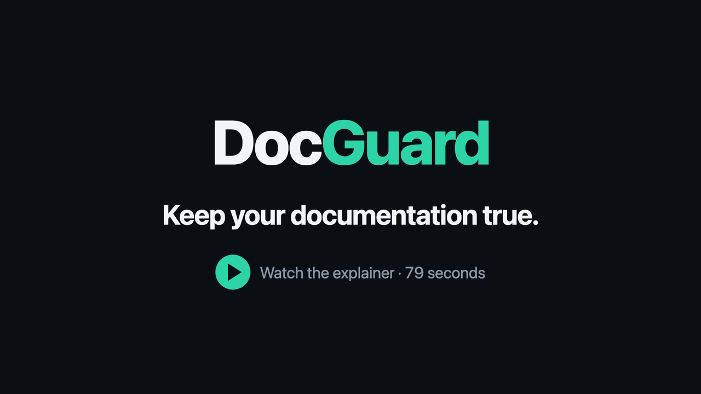

<!-- docguard:translation source=README.md lang=pt-BR reviewed=2026-10-10 -->
<!-- O README em inglês é a fonte canônica. Esta é uma versão curada — números
     e listas voláteis ficam apenas no original para nunca divergirem do código. -->

# 🛡️ DocGuard

[English](README.md) · **Português (BR)** · [Español](README.es.md)

> **A camada de enforcement para Spec-Driven Development.**
> Valide. Pontue. Garanta. Entregue documentação que agentes conseguem usar de verdade.

[](https://github.com/raccioly/docguard/actions/workflows/ci.yml)
[](https://www.npmjs.com/package/docguard-cli)
[](https://pypi.org/project/docguard-cli/)
[](https://opensource.org/licenses/MIT)

[](https://github.com/raccioly/docguard/blob/main/docs/media/docguard-explainer.mp4)

▶️ **Vídeo de 79 segundos (em inglês)**, com legendas.

---

> **✨ Veja o que o DocGuard detecta em 30 segundos — sem instalar nada:**
> ```bash
> npx docguard-cli demo
> ```

## O que é o DocGuard?

O DocGuard é a ferramenta de enforcement do **Canonical-Driven Development (CDD)**.
No CDD, a documentação é a fonte da verdade. O DocGuard **verifica, de forma
determinística, que a documentação continua verdadeira em relação ao código**.

Um resultado verde do DocGuard significa *"os documentos correspondem ao código, de forma
verificável"*. Não significa apenas "os arquivos existem".
Ele extrai rotas, schemas, variáveis de ambiente, contagens e afirmações documentadas.
Depois compara tudo com o código real. O núcleo não faz nenhuma chamada a LLM. Ele é
determinístico, offline e auditável.

## Início rápido

```bash
# no diretório do seu projeto
npx docguard-cli init       # cria os documentos canônicos (detecta seu stack)
npx docguard-cli guard      # valida — verde significa "docs corretos"
npx docguard-cli score      # nota de maturidade da documentação (0-100)
```

> **O modo estrito é o padrão.** O `docguard guard` termina com código 4 quando uma verificação que se aplica ao seu projeto não examinou nada. Por exemplo, o projeto tem rotas, mas não tem referência de API. O DocGuard então mostra o que adicionar. O DocGuard ignora uma verificação que não se aplica. Ele apenas informa um layout que não consegue ler, e a execução não falha. Atualizou e viu o build ficar vermelho? Leia [Atualizando para o modo estrito](https://raccioly.github.io/docguard/upgrading-to-strict) (em inglês). Para manter o comportamento anterior, defina `"enforcement": "standard"` no `.docguard.json`.

Para um projeto existente, o caminho inverso funciona melhor:

```bash
npx docguard-cli generate --plan --write   # engenharia reversa: docs a partir do código
```

## Os 5 comandos do dia a dia

| Comando | O que faz |
|:--------|:----------|
| `init`  | Inicializa o projeto (detecta o stack automaticamente) |
| `guard` | Compara os documentos com o código. É a verificação final no CI |
| `diff`  | Mostra a diferença entre docs e código (`--since <ref>` para impacto de PR) |
| `sync`  | Regenera as seções de "verdade do código" nos documentos |
| `score` | Nota de maturidade CDD, com detalhamento por categoria |

A lista completa de comandos, validadores e flags está no
[README em inglês](README.md#usage). O próprio DocGuard a mantém sincronizada com o código.

## Integração com IA (nativo, não improvisado)

O DocGuard foi feito para ser usado **por** agentes, não só por pessoas:

- **Servidor MCP** — `claude mcp add docguard -- npx docguard-cli mcp` oferece
  guard/score/explain/verify/diagnose como ferramentas nativas ao Claude,
  ao Cursor e a qualquer cliente MCP.
- **Contrato JSON estável** — `guard --format json` com códigos de achado
  estáveis. Você pode explicar cada código (`docguard explain <CÓDIGO>`) e suprimi-lo na linha.
- **SARIF** — `guard --format sarif` integra com o GitHub Code Scanning.
- **llms.txt / llms-full.txt / context pack** — arquivos de contexto para
  LLMs que leem o repositório.
- **GitHub Action** — anotações inline no diff do PR + comentário fixo com o
  impacto nos documentos canônicos.
- **`agents --sync`** — o AGENTS.md é a fonte canônica de CLAUDE.md, das regras
  do Cursor, das instruções do Copilot e afins. Não há duplicação manual nem drift.

Guia completo: [docs/ai-integration.md](docs/ai-integration.md) (em inglês).

## Documentação em outro idioma

O DocGuard lê documentação escrita em qualquer idioma. Ele reconhece os rótulos estruturais que procura por **id**, e não pelo texto em inglês. Esses rótulos são: os títulos obrigatórios dos documentos canônicos, a seção de mudanças ainda não lançadas do changelog, as seções do README, os nomes das seções do Spec Kit e as palavras de status dos registros de decisão. Por isso, um projeto em português ou espanhol não precisa de títulos em inglês. Há três formas de dizer qual título é qual. O DocGuard as tenta nesta ordem:

1. **Um marcador.** Escreva `<!-- docguard:heading system-overview -->` na linha logo abaixo do título que você já tem. Funciona em qualquer idioma e não exige configuração. A lista fechada de ids está em [Documents in other languages](https://raccioly.github.io/docguard/languages.html) (em inglês); `docguard explain STR009` também a mostra.
2. **`docs.language`.** Defina uma tag [BCP 47](https://www.rfc-editor.org/info/bcp47) no `.docguard.json`. O DocGuard então aceita os títulos e as palavras embutidos desse idioma. Português (`pt`, ou seja `pt-BR` e `pt-PT`) e espanhol (`es`) já vêm nesta versão. O DocGuard ignora maiúsculas, acentos e a numeração de seção no início. Ele sempre aceita o inglês, então documentos mistos funcionam.
3. **`docs.labelAliases`.** Sua própria redação, por id. Ela se soma ao conjunto embutido e nunca o substitui.

```json
{
  "docs": {
    "language": "pt-BR",
    "labelAliases": { "requirements": ["Requisitos do sistema"] }
  }
}
```

O exemplo acima mostra a redação própria de uma equipe, acrescentada ao conjunto embutido; ele não é uma tradução embutida.

**Um idioma sem conjunto embutido** (`"de"`, por exemplo) também é aceito. O DocGuard não consegue distinguir uma seção ausente de uma escrita em alemão. Por isso, ele não aponta como ausente um título obrigatório sem marcador e sem alias. O documento aparece em "DocGuard could not read" com a causa `language-not-supported` e o que acrescentar. O código de saída não muda. Quando `docs.language` está definido, o DocGuard lê nesse idioma um documento chamado `<nome>.<idioma>.md`, ou dentro de `i18n/<idioma>/` ou `locales/<idioma>/`. O DocGuard nunca deduz o idioma do texto.

**Métricas de qualidade do texto.** O DocGuard ignora a voz passiva e a legibilidade de Flesch em todos os idiomas, exceto o inglês. Ele informa o motivo de cada omissão em vez de gerar um número. O tamanho das frases continua sendo medido. Agora o DocGuard mede negação, condições, frases compostas e pronomes ambíguos (DQ007, DQ008, DQ003, DQ002) para português e espanhol, com listas de palavras revisadas por um falante nativo. Os demais idiomas continuam ignorando essas métricas.

**Documentos novos.** `docguard init` e `docguard generate` escrevem o marcador sob cada título obrigatório que geram. Com `docs.language` em `pt` ou `es`, eles escrevem o título nesse idioma (o changelog como `## [Não lançado]` ou `## [Sin publicar]`). Eles nunca reescrevem um documento que já existe.

Para marcar uma seção obrigatória que não se aplica ao seu projeto, escreva `<!-- docguard:section <slug> n/a — motivo -->`. Aqui, `<slug>` é o id da seção (por exemplo `system-overview`). O motivo deve começar com uma letra ou dígito de `A-Z`, `a-z` ou `0-9`. Guia completo: [Documents in other languages](https://raccioly.github.io/docguard/languages.html) (em inglês).

## Documentação

Os guias completos estão em inglês, em
**[raccioly.github.io/docguard](https://raccioly.github.io/docguard/)**:

| Se você quer | Guia |
|:-------------|:-----|
| Instalar com npm, PyPI, Homebrew, Docker, GitHub Action ou Spec Kit | [Installation](https://raccioly.github.io/docguard/installation.html) |
| Adotar o DocGuard em um repositório que já tem código | [Existing Projects](https://raccioly.github.io/docguard/guides/existing-projects.html) |
| Usá-lo com o GitHub Spec Kit | [Spec Kit](https://raccioly.github.io/docguard/guides/spec-kit.html) |
| Bloquear pull requests no CI | [Continuous Integration](https://raccioly.github.io/docguard/guides/ci.html) |
| Saber quais linguagens e frameworks ele lê | [Languages and Frameworks](https://raccioly.github.io/docguard/reference/languages.html) |
| Conectar seu agente de código | [Coding Agents](https://raccioly.github.io/docguard/reference/agents.html) |
| Entender um código de achado | [Finding Codes](https://raccioly.github.io/docguard/reference/findings.html) |
| Resolver um problema | [Troubleshooting](https://raccioly.github.io/docguard/guides/troubleshooting.html) |

## Instalação permanente

```bash
npm install -g docguard-cli    # Node.js 18+
# ou via Python:
pip install docguard-cli       # wrapper PyPI (requer Node.js 18+)
```

## Comunidade

- [Discussões](https://github.com/raccioly/docguard/discussions) — perguntas e ideias
- [Issues](https://github.com/raccioly/docguard/issues) — bugs e pedidos de feature
- [CHANGELOG](CHANGELOG.md) — histórico completo de versões
- [Como contribuir](CONTRIBUTING.md)

---

**Licença MIT** · Feito para times que tratam documentação como contrato, não como enfeite.
